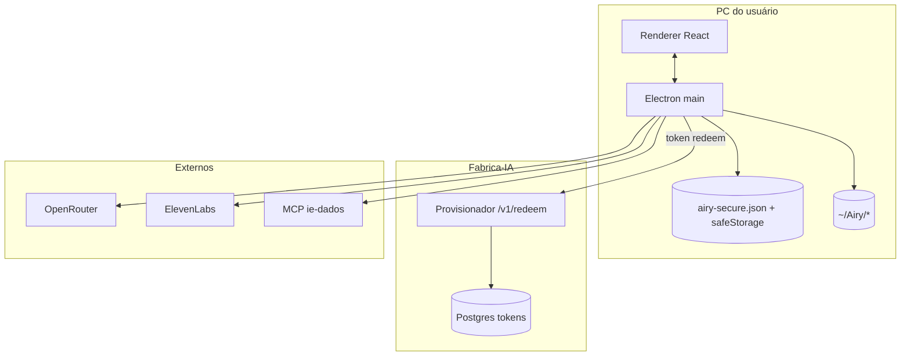

# Esquema Backend — Airy

> Modelagem de dados e API.
> Fonte: [x] Entrevista com usuário  [x] Leitura de código existente
> Depende de: [TRD](TRD.md)

**Data**: 2026-03-13

> O “backend” do produto é **híbrido**: (1) processo Electron + arquivos locais no PC; (2) APIs de terceiros; (3) na Onda 1, um **provisionador HTTP magro** na VPS Fabrica-IA. Não há API multi-tenant do Airy para o usuário final.

## 1. Entidades principais

### 1.1 Desktop local (as-is + extensão Onda 1)

| Entidade | Campos-chave | Onde | Relacionamentos |
|---|---|---|---|
| **PublicSettings** | `ownerName`, `radarUrl`, `openrouterModel`, `elevenVoiceId`, params TTS, `mcpBaseUrl`, inbox* | `userData/airy-secure.json` → `public` | 1:1 por instalação |
| **SecretSettings** | `openrouterApiKey`, `elevenApiKey`, `mcpToken` | Mesmo arquivo → `secrets` cifrados (`safeStorage`) | 1:1 |
| **MemoryItem** | `id`, `text`, `tags[]`, `createdAt`, `updatedAt` | `~/Airy/memory.json` (máx. ~80) | N por usuário/máquina |
| **Note** | arquivo `.md` | `~/Airy/notas/` | N |
| **Artifact** | HTML gerado | `~/Airy/artifacts/` | N |
| **Inbox file** | qualquer arquivo dropado | `inboxPath` (default `~/Airy/inbox`) | watch FS → evento IPC |

**Extensões Onda 1** (novos campos em `public` ou arquivo irmão versionado):

| Campo / entidade | Uso |
|---|---|
| `assistantName` | Nome da IA (UI) |
| `openPreferApp` / mapa por pacote | App web vs browser (ex. Radar) |
| `enabledPackages: string[]` | Toggles allowlist (ChatGPT, Notion…) |
| `newsSources: { id, label, type: rss\|url, url, enabled }[]` | Fontes + atalho CNN→YouTube |
| `voiceCatalog?: { id, label }[]` | Opcional cache local das vozes escolhíveis |

### 1.2 Provisionador VPS (novo — Onda 1.1b)

Postgres dedicado (serviço isolado EasyPanel):

| Entidade | Campos-chave | Relacionamentos |
|---|---|---|
| **InstallToken** | `id`, `token_hash`, `payload_json`, `max_uses`, `uses_count`, `expires_at`, `created_at`, `revoked_at` | 1 token → 1 payload de credenciais |
| **RedeemEvent** (opcional) | `id`, `token_id`, `redeemed_at`, `client_meta` (sem secrets) | N por token |

- Guardar **hash** do token, não o token em claro.
- `payload_json` = shape do TRD §7.2 (secrets + public defaults). Em repouso: preferir cifrar coluna ou restringir acesso DB ao serviço.
- Sem tabela de “tenants/usuários admin” na Onda 1 — seed via script/MCP VPS.

### 1.3 Externos (não modelados no Airy)

| Sistema | Papel |
|---|---|
| OpenRouter / ElevenLabs | Contas e billing fora |
| MCP ie-dados | Tools dinâmicas; auth path-token |
| RSS feeds | Fetch read-only |

## 2. Autenticação e autorização

| Camada | Método | Papéis |
|---|---|---|
| Desktop | Sem login; posse da máquina + cofre local | Usuário daquele PC |
| IPC renderer↔main | `contextBridge` estreito (`preload.ts`); sem Node no renderer | Só canais `airy:*` |
| Tools desktop | Allowlist URL/app (+ toggles Onda 1) | O que o settings permitir |
| MCP | Path `/key/{MCP_TOKEN}/mcp` | Token = capability do servidor ie-dados |
| Provisionador `/redeem` | Bearer ou body com **token de instalação** opaco | Sem papéis; rate limit + TTL/usos |
| Operador Fábrica | Acesso VPS/MCP (fora do app) | Cria/revoga tokens |

OAuth Google (Agenda/Docs/Mail) = **Onda 3** — não no esquema Onda 1.

## 3. Endpoints / ações principais

### 3.1 IPC desktop (API interna — as-is)

| Ação | Método | Auth | Regra |
|---|---|---|---|
| `airy:ready` | invoke | local | Boot + settings view |
| `airy:settings-get` / `save` | invoke | local | Persiste public+secrets |
| `airy:text-turn` / `voice-turn` | invoke | local + keys | Agent + tools |
| `airy:speak` / `transcribe` / `enroll-name` | invoke | local | Voz |
| `airy:pick-folder` / `default-inbox-path` | invoke | local | Inbox |
| `airy:inbox-file` | event | local | Novo arquivo |

**Novo Onda 1:** `airy:redeem-token` → HTTPS redeem → `saveSettings` → não logar payload.

### 3.2 Provisionador VPS

| Endpoint | Método | Auth | Regra |
|---|---|---|---|
| `GET /health` | GET | não | Liveness |
| `POST /v1/redeem` | POST | token no body | Valida hash, TTL, usos; incrementa `uses_count`; devolve JSON settings; 401/410 se inválido |
| (ops) seed token | script/SQL | acesso VPS | Sem UI admin |

### 3.3 MCP ie-dados (consumido)

| Ação | Método | Auth | Regra |
|---|---|---|---|
| `initialize` / `tools/list` / `tools/call` | JSON-RPC HTTP | path-token | Cliente em `mcp.ts` |

### 3.4 Terceiros (agent)

| Ação | Destino |
|---|---|
| Chat + tools | OpenRouter `chat/completions` |
| STT / TTS | ElevenLabs |
| Research | OpenRouter modelo Sonar |
| `read_news` | RSS HTTP |

## 4. Processamento assíncrono

| Mecanismo | Uso |
|---|---|
| Turno agent (main process) | Síncrono do ponto de vista IPC; awaits longos (LLM/tools/TTS) |
| `inboxWatch` | `fs.watch` + debounce → evento renderer → possível `textTurn` |
| Provisionador | Request/response; **sem** fila na Onda 1 |
| (Depois) | Jobs de sync Google / refresh catalogo de vozes — Onda 2–3 |

## 5. Armazenamento

| Tipo | O quê | Volume esperado |
|---|---|---|
| JSON cifrado/local | Settings + secrets | 1 arquivo / máquina |
| JSON / Markdown / HTML | memória, notas, artifacts | Baixo (uso pessoal) |
| Pasta inbox | PDFs/arquivos dropados | Baixo–médio |
| Postgres VPS | tokens + payloads | Dezenas–centenas de tokens no início |
| Áudio | Transitório em memória (base64) no turno; **não** persistir gravações por padrão | — |

Dados sensíveis: API keys e `mcpToken` → só cofre; payload no redeem trafega HTTPS e some da UI após gravar.

### Diagrama lógico (Onda 1)

---

## Gaps & Recomendações (Modo B)

- [x] **Gap**: settings Onda 1 (pacotes, notícias, `assistantName`) ainda não existem no schema.  
  **Rec**: migrar `DiskFile.version` 1→2 com defaults seguros.

- [x] **Gap**: provisionador inexistente.  
  **Rec**: serviço mínimo + tabela `InstallToken`; seed manual; `/health` + rate limit.

- [x] **Gap**: doctor não lê o mesmo store que o app.  
  **Rec**: doctor/IPC validation sobre `loadSettings()`, não só `.env`.

- [x] **Gap**: `plain:` fallback se `safeStorage` indisponível.  
  **Rec**: avisar no Start; em produção preferir bloquear ou alertar forte.

- [x] **Gap**: memória/notas em claro em `~/Airy`.  
  **Rec**: aceitável Onda 1 (dado do usuário no home); documentar; cifrar depois se B2B exigir.

- [x] **Gap**: MCP path-token na URL pode vazar em logs de proxy.  
  **Rec**: lado ie-dados/ops; Airy não loga a URL completa.

- [x] **Gap**: sem backup/export de settings.  
  **Rec**: Onda 2 (export local); não misturar com redeem.
