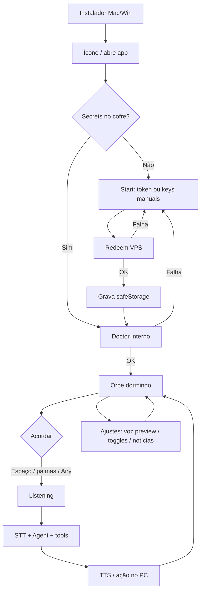
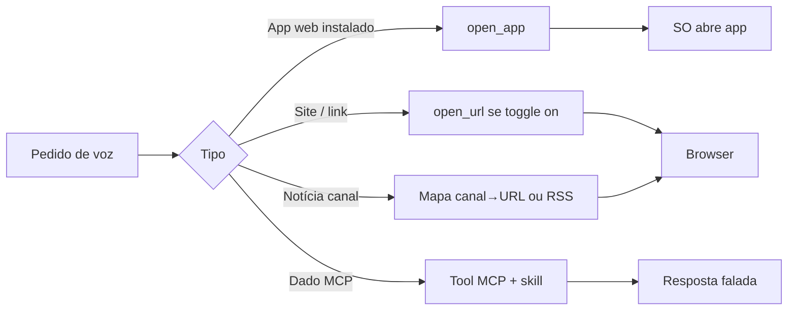

# Fluxo do App — Airy

> Como o usuário se move pelo produto.
> Fonte: [x] Entrevista com usuário  [x] Leitura de código existente
> Depende de: [PRD](PRD.md) · [TRD](TRD.md)

**Data**: 2026-03-13

## 1. Perfis de usuário

| Perfil | Descrição | Permissões principais |
|---|---|---|
| **Usuário final** | Gestor/operação no desktop; não técnico | Usar voz, Start/Ajustes, toggles locais, redeem de token |
| **Operador Fábrica** | Fred / bastidor | Gerar tokens no provisionador VPS, build de instaladores, MCP |
| **(Depois)** Integrador | Conecta outras soluções ao canal | Fora da Onda 1 |

Não há login de conta no app desktop hoje *(código)* — a “identidade” é a máquina + cofre local + (Onda 1) token de instalação.

## 2. Jornadas principais

### Jornada A — Instalação e primeiro uso (as-is hoje)

Perfil: Usuário final (hoje na prática assistido por IA/dev)

1. Clona o repo / recebe pasta.
2. Instala Node 20+, roda `npm install` ou `setup-mac.sh`.
3. (Opcional) Copia `.env` ou abre o app e tecla `,` para colar keys.
4. `npm run doctor` / smoke (se souber).
5. `npm run desktop-shortcut` ou `npm run dev`.
6. Concede mic; orbe em **dormindo**.
7. Acorda (Espaço / palmas / “Airy …”) e conversa.

Telas: shell fullscreen + orbe; `SetupSheet` (`,`); sem wizard de Start.  
Fluxo de erro: keys erradas → 401; doctor pode mentir se só UI estiver ok; path/npm quebra o atalho.

### Jornada B — Instalação e primeiro uso (Onda 1 — alvo)

Perfil: Usuário final

1. Baixa instalador Mac **ou** Windows (`install/mac` ou `install/win`).
2. Instala → ícone na área de trabalho → abre o **binário** (sem terminal).
3. **Start** (primeira vez ou sem secrets):
   - Nome da IA / como chama a pessoa (opcional nesta tela).
   - Campo **token de instalação** → redeem VPS → grava cofre.
   - Fallback: colar keys manualmente.
4. App valida (doctor interno alinhado ao cofre) → estado pronto.
5. Permissão de microfone (SO).
6. Orbe **dormindo** → usuário acorda e fala → resposta com voz.

Telas envolvidas: Instalador OS → Start → Orbe (home) → Ajustes.  
Fluxo de erro: token inválido/expirado → mensagem clara + fallback manual; sem rede no redeem → fallback; mic negado → instrução no Start.

### Jornada C — Sessão de voz (as-is e permanece)

Perfil: Usuário final

1. App aberto, sessão `dormant` (“dormindo”).
2. Acorda por: **Espaço** (PTT), **2 palmas**, ou frase **“Airy …”** *(código: `App.tsx`, clap/name wake)*.
3. Se sem `ownerName`, pode entrar enroll de nome *(código)*.
4. `listening` → grava → `busy` (thinking) → tools/LLM → TTS → orbe `speaking`.
5. Volta a escutar ou dorme (“para” / Esc / tool `session_stop`).

Telas: só a home do orbe (+ sheet de texto `/`).  
Erro: falha STT/TTS/API → `setError` na UI; sessão não deve travar em `busy` (há recuperação parcial no histórico de commits).

### Jornada D — Configurar e personalizar (Onda 1)

Perfil: Usuário final

1. Abre **Start** (boot) ou **Ajustes** (`,`).
2. Ajusta: nome IA, nome pessoa, voz (com **preview**), Radar URL, modelo.
3. Liga/desliga **pacotes** (sites/apps permitidos da lista Ary).
4. Escolhe fontes de notícia / atalhos canal→URL (ex. CNN live).
5. Pasta vigiada (picker melhorado); opcional sync Drive local.
6. Salva → cofre/settings → efeito imediato nas tools.

Erro: preview de voz falha → não sobrescreve Voice ID salvo; path inválido → mensagem.

### Jornada E — Pedir ação no computador

Perfil: Usuário final

1. Acorda e pede (“abre o Notion”, “Radar”, “CNN”, “ChatGPT”).
2. Agente escolhe tool: `open_app` (app/PWA instalado) vs `open_url` (browser) conforme intenção + toggles.
3. Se bloqueado por toggle/allowlist → fala curta explicando.
4. Se Radar: usa URL da config; se marcado como app web, tenta app local.

Erro (as-is): “URL bloqueada / app não está na allowlist” — dor reportada pelo Ary.

### Jornada F — Provisionar token (operador — bastidor Onda 1)

Perfil: Operador Fábrica

1. Gera registro token → payload JSON no Postgres do provisionador (script/MCP VPS, sem admin UI).
2. Entrega token ao usuário (mensagem segura).
3. Usuário cumpre Jornada B passo 3.
4. Token consome uso/TTL conforme regra do TRD.

## 3. Diagrama — Onda 1 (primeiro uso + sessão)

---

## Gaps & Recomendações (Modo B)

- [x] **Gap**: não existe jornada de Start/primeiro uso — só orbe + `,`.  
  **Recomendação**: Start obrigatório sem secrets (Jornada B).

- [x] **Gap**: instalação = jornada de desenvolvedor (A), não de produto.  
  **Recomendação**: substituir A por B na Onda 1; manter A só para contribuidores.

- [x] **Gap**: Ary trava em credenciais e allowlist no meio da Jornada C/E.  
  **Recomendação**: token (B) + pacotes com toggle (D/E) antes de polir orquestrador.

- [x] **Gap**: “aplicativo web vs browser” não é jornada explícita no agente.  
  **Recomendação**: prompt + routing `open_app`/`open_url` + preferência por item (Radar).

- [x] **Gap**: operador não tem fluxo documentado para entregar keys.  
  **Recomendação**: Jornada F mínima (script + token), sem admin multi-tenant.

- [x] **Gap**: Google Agenda/Mail não tem jornada ainda.  
  **Recomendação**: Onda 3 (PRD); não desenhar na Onda 1.
